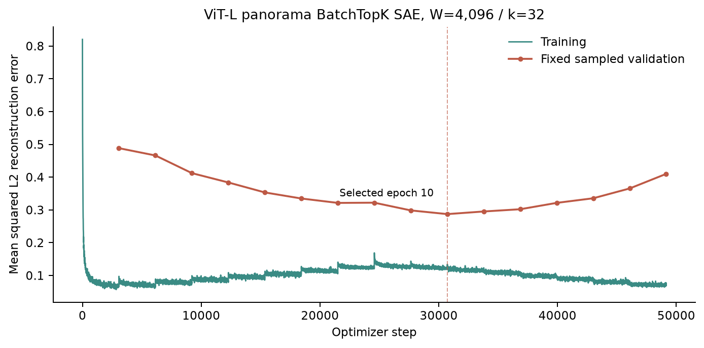

# Urban Scene Primitives

用冻结的 DINOv3 patch 表征和 BatchTopK SAE，研究街景视觉单元、语义关系及组合模式。

## 实验版本导航

**当前主实验是第一行的 30 城市 ViT-L、W4096/K32。** 各版本的代码、配置、结果和 README 集中在自己的目录。完整对照见 [实验索引](experiments/README.md)。

| 实验目录 | 数据与参数 | 内容 / 状态 |
| --- | --- | --- |
| [vitl30_panorama_w4096_k32](experiments/vitl30_panorama_w4096_k32/) | 30 城市；ViT-L/16；D=1024；W=4096，K=32 | **主实验**；16 轮训练完成；激活、语义 UMAP、景观组合；逐维 VLM 继续运行 |
| [global307_baseline_w1024_k8](experiments/global307_baseline_w1024_k8/) | 307 候选 / 304 缓存城市；W=1024，K=8 | 全球基线、城市清单、训练与编码 |
| [global307_dictionary_scaling_k8](experiments/global307_dictionary_scaling_k8/) | 全球缓存；W=512/1024/2048，K=8 | 字典增宽后的稳定、分流与未匹配关系；Sankey 和交互实例 |
| [global307_w4096_k_sweep](experiments/global307_w4096_k_sweep/) | 全球缓存；W=4096，K=16/32/64 | 稀疏预算消融、四视角激活图库 |
| [global307_w2048_k64](experiments/global307_w2048_k64/) | 全球缓存；W=2048，K=64 | Top100 语义 UMAP、共现显著性及空间检验 |
| [global307_w4096_k64](experiments/global307_w4096_k64/) | 全球缓存；W=4096，K=64 | K 消融模型的 Top100 语义分析 |
| [legacy30_paper_w1024_k8](experiments/legacy30_paper_w1024_k8/) | 早期论文 30 城市；W=1024，K=8 | 历史论文材料；缺少可核对的对应本地 checkpoint |
| [legacy12city](experiments/legacy12city/) | 早期 12 城市 | 历史图片留档 |
| [city37_plan](experiments/city37_plan/) | 37 城市；每城目标 12,800 点 | 早期采样方案和守护脚本 |
| [semantic_pipeline_smoke](experiments/semantic_pipeline_smoke/) | 8 城市、32 张方向图像 | 语义流水线试运行 |

`D` 是 SAE 输入及重建维度，`W` 是字典宽度，`K` 是 BatchTopK 的批次平均激活预算。不同 checkpoint 的同编号 feature 不代表同一语义。

## 当前主实验

四方向街景 → 每方向冻结 DINOv3 ViT-L/16（448×448 → 28×28×1024）→ 环形 panorama context mixing → 逐 patch BatchTopK SAE（1024 → 4096 → 1024，K=32）→ 激活图、64 组归纳、语义与组合分析。

- 实际复用缓存：**89,031 个全景**，训练 85,191，验证 3,840（每城 128）。实际数据身份以 experiment.json 和 cached_feature_map.json 为准。
- 完成 16 轮，每轮每方向访问 49 个位置，16 轮覆盖全部 784 个位置。训练记录与图见 [主实验结果](experiments/vitl30_panorama_w4096_k32/results/)。
- Top100 证据来自能回溯原图的 29 城市、3,712 个验证全景。逐维语义 UMAP 有 2,863 点，Top10 图像实例 UMAP 有 29,934 点。
- VLM 名称是待复核的语义候选，当前没有独立验证的逐维语义准确率。



## 文件约定

```text
experiments/<版本>/
  README.md       数据、参数、入口、结果与限制
  code/           本版本脚本和模板
  configs/        本版本清单与配置（如适用）
  tests/          本版本验证（如适用）
  results/        GitHub 发布的摘要、表格和代表图
  outputs/        服务器缓存、模型、原始分析产物
  reports/        服务器完整报告、交互页与图像资源
  runtime/        日志、进程状态（如适用）
sae_experiments/   共用模型、backbone、特征缓存和语义工具
formal/quality/   共用隧道 / 全黑筛查器
docs/            方法示意图、文件盘点与迁移记录
archive/          Feature-MAE、道路 MRLU 等已归档研究线
```

GitHub 发布代码和精选结果；大体积模型、特征、Top100 裁剪和完整图库留在对应版本目录或 NAS。检查点与街景原图不随 Git 克隆。ViT-B SAE 代码和结果已按之前的要求移除。

## 运行与兼容

在仓库根目录运行模块。现有 sae_experiments.panorama_vitl30_*、formal.gpu_run 和 formal.analysis.* 命令通过包路径兼容，实际源码在各版本目录。旧 configs/、reports/、outputs/ 路径保留相对符号链接，避免后台任务和历史清单失效。

```bash
# 只读查看主实验状态
python -m experiments.vitl30_panorama_w4096_k32.code.panorama_vitl30 status

# 逐维 VLM 断点续跑；已有后台进程时运行锁阻止重复启动
python -u -m sae_experiments.panorama_vitl30_dimension_vlm_runner --devices 1,3 --batch-size 1

# 共用及各版本测试，不遍历缓存与图库
python -m pytest -q
```

主要依赖：PyTorch、torchvision、transformers、NumPy、pandas、SciPy、scikit-learn、Pillow、matplotlib、UMAP。训练和 VLM 需要服务器上的权重及数据映射；历史脚本中的 NAS 路径需按运行环境配置。

重排详情见 [迁移记录](docs/project_inventory/layout_migration.json)；之前的占用与清理记录见 [文件盘点](docs/project_inventory/README.md)。
