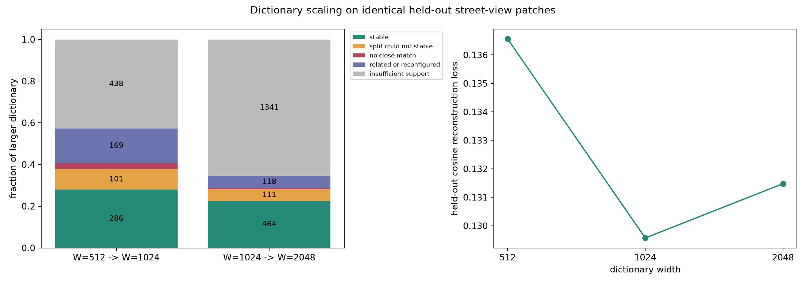
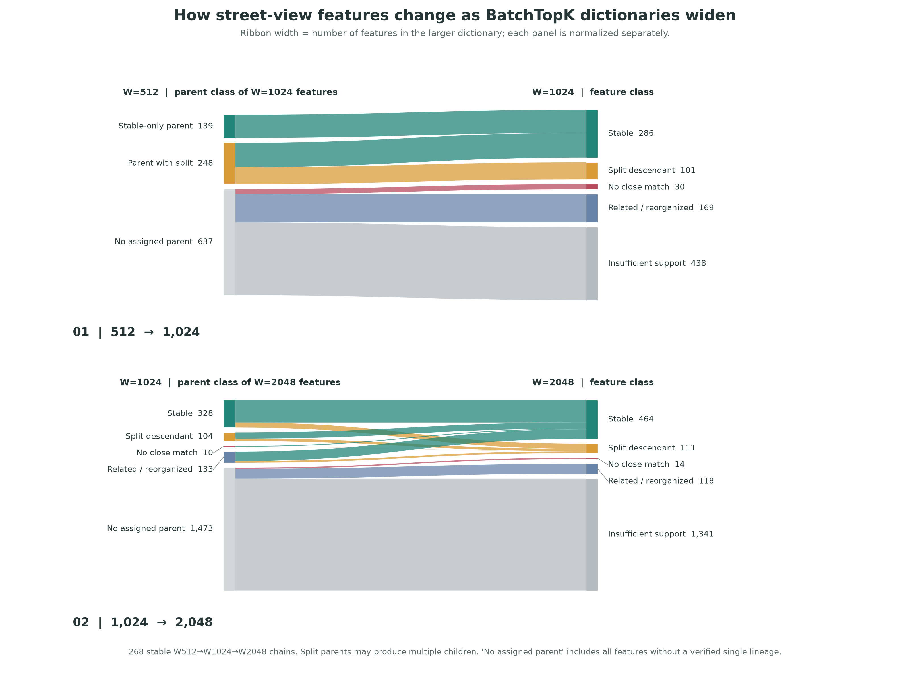
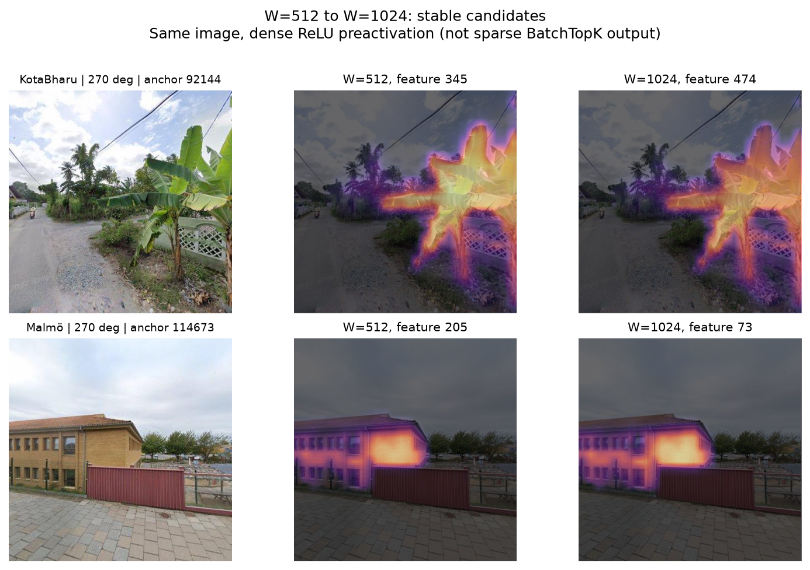
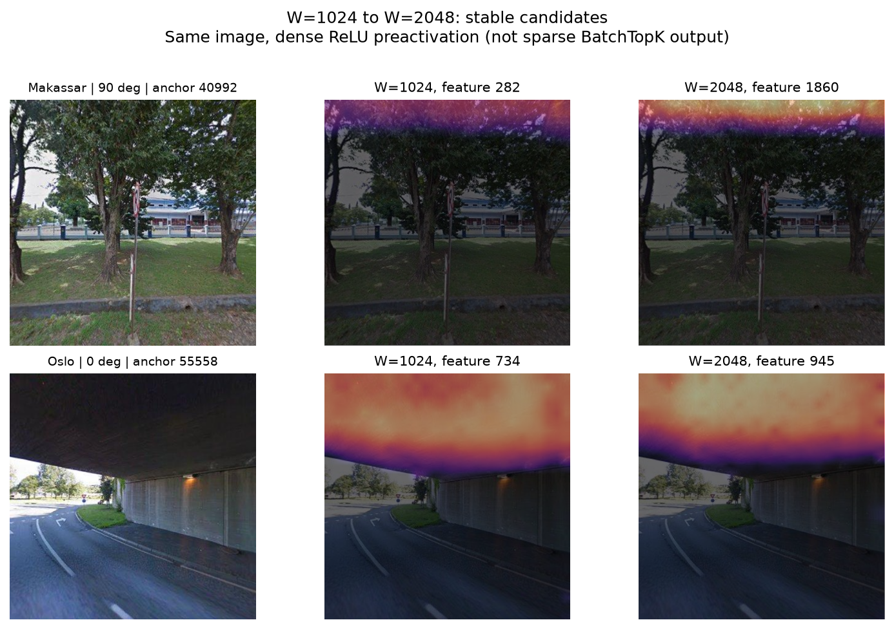
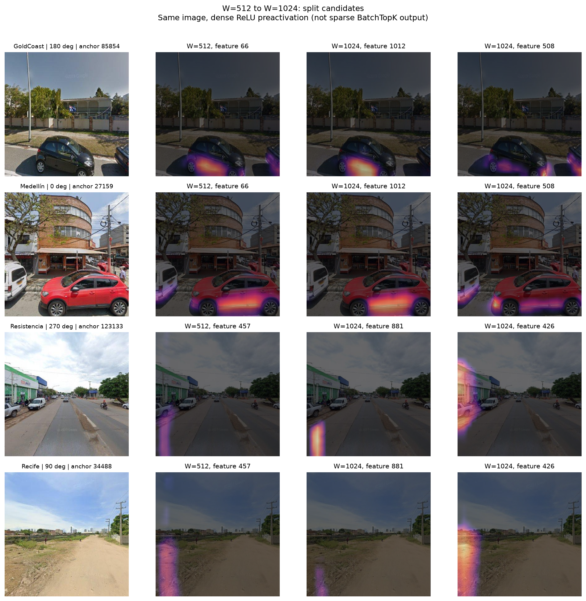
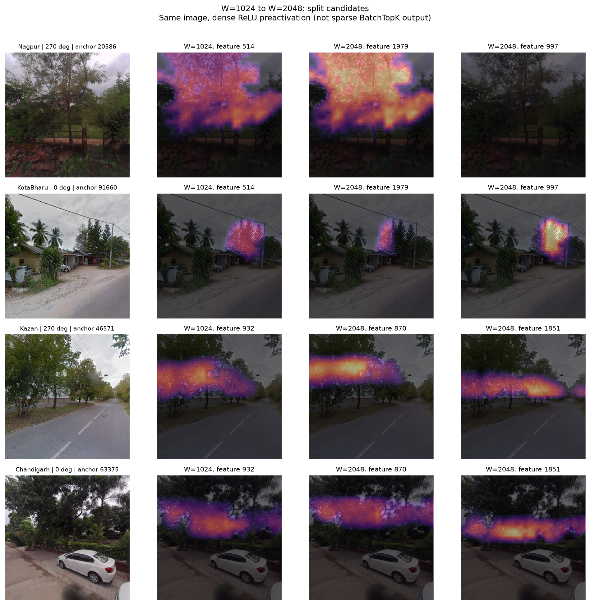
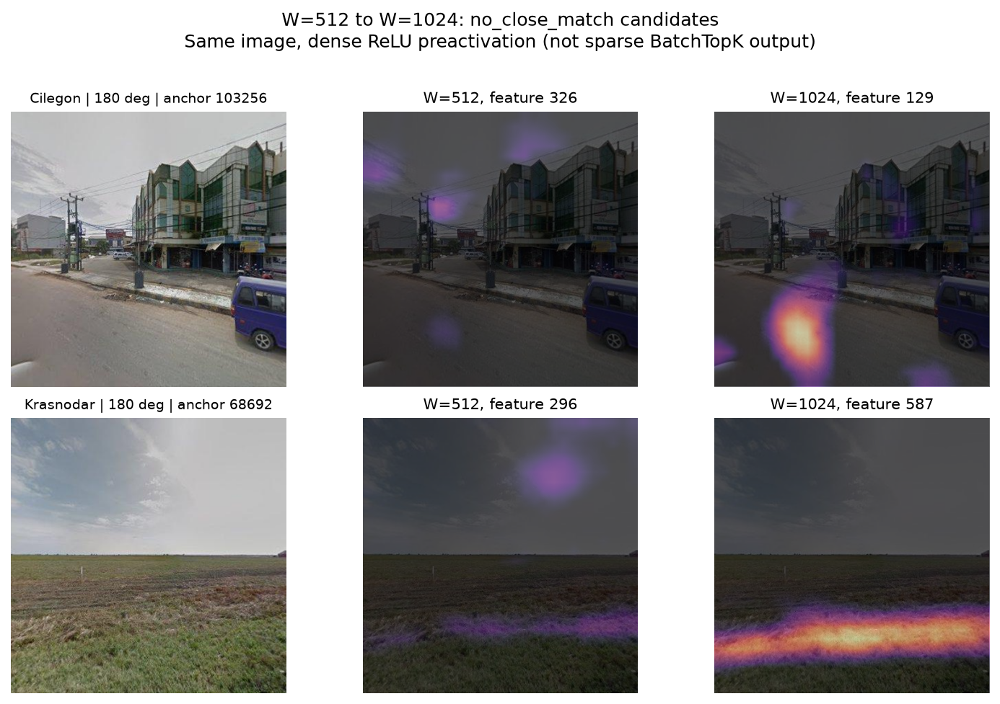
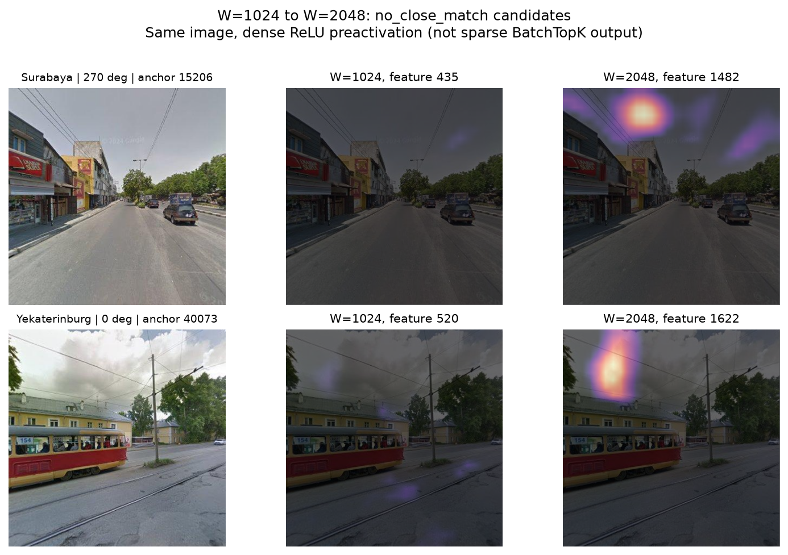
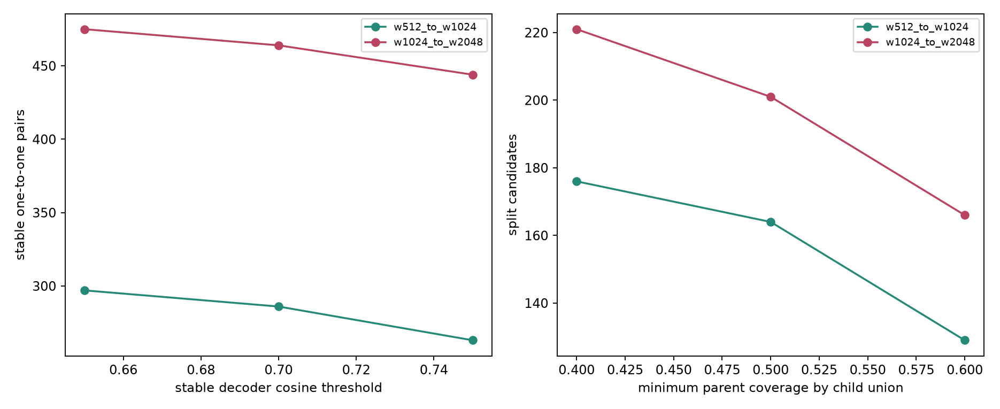

# Urban Scene Primitives：字典宽度与街景特征的稳定、分流和变化

本轮只比较已经训练完成的 BatchTopK SAE 字典 `W=512、1024、2048`，三者的平均稀疏预算均为 `k=8`。没有重新训练 SAE，也没有开展街景模板发现。

目前证据支持：扩大字典后，一批视觉响应保持稳定，一批旧响应出现互补的子响应，也有少量有足够支持但缺少旧特征对应的候选。与此同时，大字典增加了大量在评估样本中从未激活的特征，因此字典宽度不能直接当作语义单元的数量。三种宽度、每种一个训练初始化，只能支持规模比较，尚不能称为普适的尺度定律。

## 评估样本和比较方法

- 从 295 个 QC 映射计数可信的城市中，每城均衡抽取 4 个 panorama，共 1,180 个完整四视角采样点。9 个映射不可信城市本轮排除。
- 按现有 30M-row 训练缓存的城市顺序、均衡配额和确定性起点，排除所有与训练行区间相交的 panorama，包括只被训练缓存使用部分 patch 的端点。
- 每个 panorama 四个方向各随机选 32 个 patch，共 151,040 个 patch。使用同一输入、同一行顺序、同一 `batch_size=4096` 对三个模型编码。无须重提 DINOv3 特征。
- 比较 decoder 方向余弦相似度、全部评估行上的稀疏激活余弦相似度、正激活 support Jaccard，以及父特征被子特征覆盖的比例。零激活行不用于构建高激活例子。
- 图像路径从原采样清单和旧 QC gate 恢复，要求该城市恢复的 panorama 数量与源分片一致。此校验是计数及顺序重建，不是重新提特征的逐向量核验。

“held-out”指未进入这次 SAE 的训练缓存；城市本身已在训练中出现，不代表未见城市泛化，也不代表未进入 DINOv3 预训练。

## 分类规则

**稳定匹配**：在 decoder 和激活联合相似度上互为最佳对应；decoder cosine ≥ 0.70、activation cosine ≥ 0.35、support Jaccard ≥ 0.15，两边均至少有 25 个正激活 patch。

**分流候选**：至少两个子特征与父特征的 decoder cosine ≥ 0.45；各覆盖至少 15% 的父激活、至少 20% 的子激活落在父支持中；两者合计覆盖至少 50% 的父激活，而且各自独占至少 10% 的父支持。这样排除只复制同一响应的重复子特征。每个父特征输出最有支持的一对子特征，本轮没有穷举所有可能的多子分支。

**无近似对应候选**：较大字典特征至少有 25 个正激活 patch，但与全部较小字典特征相比，最大 decoder cosine < 0.45，最大 activation cosine < 0.25。这只说明按当前比较没有可信单个旧特征对应，不能排除它由多个旧特征共同表达，也不等于发现了新的对象类别。

另保留“有关联但重组/证据未达阈值”和“激活支持不足”两类，避免把所有未匹配特征误当成新语义。

## 主要数量

| 比较 | 稳定一对一匹配 | 分流父特征候选 | 较大字典中无近似对应的候选 |
|---|---:|---:|---:|
| 512 → 1024 | 286 | 164 | 30 |
| 1024 → 2048 | 464 | 201 | 14 |

稳定和分流是可同时成立的关系：一个父特征可能保留一个非常接近的后继，同时还出现额外分支。它们不能相加当作互斥的父特征数量。两次稳定匹配可以连接成 **268 条 `512→1024→2048` 链**；这里只检验了相邻宽度，不代表链两端已直接通过相同阈值。

较大字典的互斥归类如下：

| 类别 | W=1024，相对 512 | W=2048，相对 1024 |
|---|---:|---:|
| 稳定匹配的后继 | 286 | 464 |
| 分流子特征，排除已计入稳定者 | 101 | 111 |
| 无近似对应 | 30 | 14 |
| 有关联但重组/未达关系阈值 | 169 | 118 |
| 支持不足 | 438 | 1,341 |
| 合计 | 1,024 | 2,048 |



### 特征流向桑基图



图分为 `512→1024` 和 `1024→2048` 两段。每段带宽按**较大字典的特征数**计算，并分别归一化，因此左侧数字表示有该类来源的后继数，不是不同父特征的个数；一个旧特征可以对应多个分流后继。绿带为稳定延续，橙带为分流后继，红带为没有近似旧对应的候选。蓝灰色是有一定关联但没有可靠的一对一归属，浅灰色是激活支持不足；这些没有可靠来源的特征统一从“无确定父特征”流入，不能据图断言它们全是新语义。第二段的绿色到绿色带对应 268 条跨三种宽度的稳定链。[矢量版](figures/dictionary_scaling_sankey.svg)和[逐带计数表](tables/dictionary_scaling_sankey_flows.csv)可用于论文排版和核查。

## 有哪些街景特征稳定、分流或变化？

以下描述来自本轮示例图的人工查看，属于局部视觉解释，不是对全部候选的语义确认。

**稳定的例子**：Kota Bharu 的 `W512:f345 → W1024:f474` 在同一片香蕉叶区域产生非常相近的响应；Malmö 的 `f205 → f73` 在同一建筑立面区域响应相近。`W1024:f734 → W2048:f945` 对桥底/上方覆盖区域的响应也相近，但需要额外样本排除单纯的图像顶部位置偏好。





**分流的例子**：`W1024:f514 → W2048:[f1979,f997]` 在 Nagpur 和 Kota Bharu 的两张图中分别由不同子特征承担树木相关响应，符合“共同父响应下出现样本分工”的候选证据。是否对应树冠形态或树种差异，需要更多正负例才能命名。`W512:f66 → W1024:[f1012,f508]` 在车辆区域出现不同局部响应，但暂不能断言对应车身侧面与车头类别。另一组 `W512:f457 → [f881,f426]` 主要位于图像左缘，提醒我们统计分流也可能是位置模式的分化。





**无近似对应的例子**：`W2048:f1482、f1622` 的示例主要响应天空或图像上方局部；`W1024:f129、f587` 的示例主要响应图像下方或地表区域。它们统计上缺少较小字典的可信对应，但目前不能称作新的景观对象，更可能需要检查位置、地表纹理及采集伪影。每张图都同时展示按联合相似度选出的最近旧特征。





关系统计使用**稀疏 BatchTopK 输出**。上述 overlay 为了避免不同图像组成 batch 后产生选择变化，展示**稠密 ReLU preactivation**；每行父子图使用共同色标。因此 overlay 用于辅助查看响应区域，不能代替稀疏分流统计。全部示例位置、原图路径和关系指标保存在 [图像证据记录](figures/image_evidence.json)。

## 字典增大并不自动提升表示

| W | 有至少 25 个正激活样本的特征 | 零支持特征 | held-out cosine loss |
|---|---:|---:|---:|
| 512 | 339 | 173 | 0.13656 |
| 1024 | 586 | 437 | 0.12957 |
| 2048 | 707 | 1,340 | 0.13148 |

各模型仍平均每 patch 激活 8 个特征。1024 到 2048 时，名义宽度翻倍，但有支持的特征只从 586 增到 707，重构损失还略高。当前检查的是评估集上的零支持，不能仅据此断言这些特征在全部训练数据上都是永久死特征。

## 阈值敏感性

改变最小支持数 `10/25/50`、稳定 decoder cosine `0.65/0.70/0.75`、分流父覆盖比例 `0.40/0.50/0.60`，共 54 组比较：

| 比较 | 稳定匹配范围 | 分流父特征范围 | 无近似对应范围 |
|---|---:|---:|---:|
| 512 → 1024 | 263–297 | 129–176 | 29–31 |
| 1024 → 2048 | 444–475 | 166–221 | 14 |

稳定与分流的现象在这些阈值下存在，具体数量依赖操作性定义。该敏感性检查未覆盖激活相似度和 decoder 分流阈值的所有组合，也没有替代多个独立训练 seed 的检验。



## 产物与复现

完整 NAS 结果目录：`/host/root/mnt/nas/huangyj/GoogleSV/urban_visual_gene/formal_batchtopk_scaling_heldout_295city_4pano`。

本地可审阅产物：

- [汇总](tables/summary.json)
- [1024 字典逐特征关系 CSV](tables/feature_relations_w512_to_w1024.csv)
- [2048 字典逐特征关系 CSV](tables/feature_relations_w1024_to_w2048.csv)
- [跨三种宽度的稳定链](tables/stable_three_width_chains.json)
- [阈值敏感性 CSV](tables/threshold_sensitivity.csv)

复现分析：

```bash
python -m formal.analysis.analyze_heldout_scaling \
  --outdir /host/root/mnt/nas/huangyj/GoogleSV/urban_visual_gene/formal_batchtopk_scaling_heldout_295city_4pano \
  --per-city 4 --patches-per-pano 128 --device cuda:1 --io-workers 8
```

复现图像证据：

```bash
python -m formal.analysis.plot_heldout_scaling \
  --result-dir /host/root/mnt/nas/huangyj/GoogleSV/urban_visual_gene/formal_batchtopk_scaling_heldout_295city_4pano \
  --outdir /host/root/mnt/nas/huangyj/GoogleSV/urban_visual_gene/formal_batchtopk_scaling_heldout_295city_4pano/figures \
  --examples 2 --device cuda:1
```

针对性测试覆盖连续 QC 删除位置的反向映射、四方向均衡采样、完整激活支持指标、重复子特征与互补分流的区分。本轮 6 个相关测试通过。
