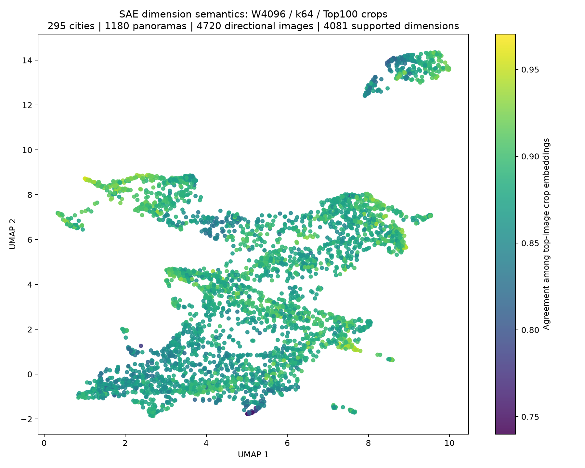
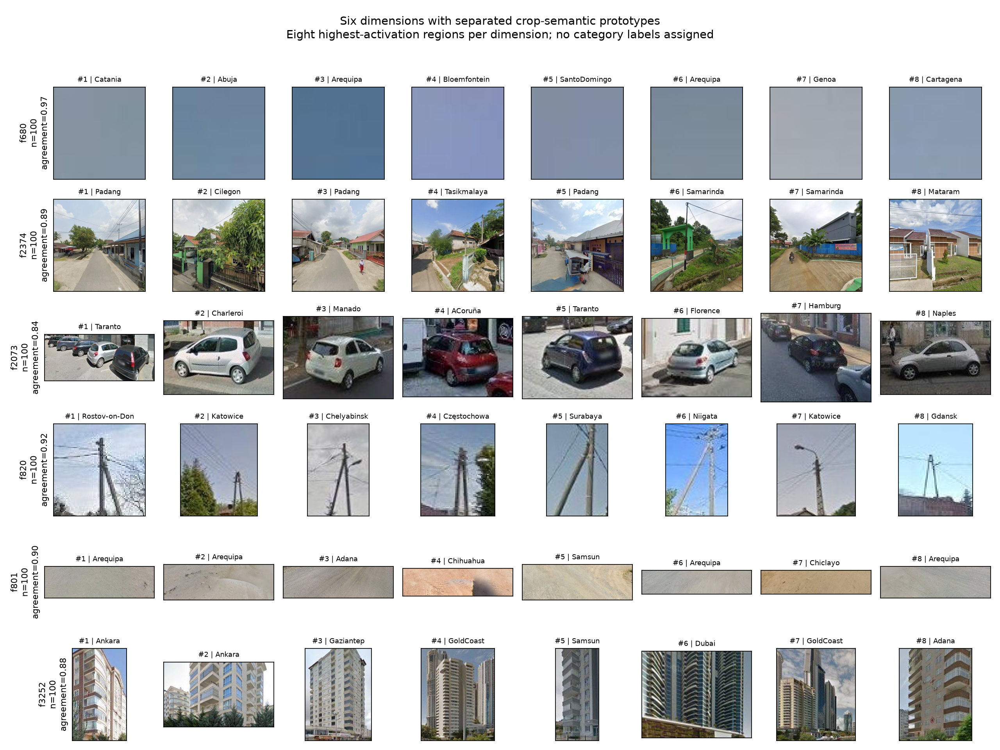

# 最新 SAE 的维度语义 UMAP 测试

2026-10-12 已完成。使用最近完成的 W=4096、BatchTopK k=64 模型；输入为 1024 维 DINOv3 contextualized patch。模型来自 307 城市候选数据集，实际训练缓存为 304 城市、3,000 万 patch、60 epochs。

分析范围为现有 QC 核验、SAE 训练排除的 295 城市，每城 4 个 pano，共 1,180 pano、4,720 张方向图像；上海百度全景按训练方式切出四视角。对每张图的全部 784 patch 计算完整 pano 的稀疏 BatchTopK 激活，以最大 patch 激活对不同图像排名，每维取 Top100。此排名仅限当前样本，不能解释为整个 NAS 上的全量 Top100。

峰值连通激活区域裁剪 → SigLIP 图像 encoder → 每例 L2 归一化 → 每维等权均值后归一化 → 余弦 UMAP。最终得到 400,240 个有效裁剪区域，裁剪错误为 0；3,885 个维度有完整 Top100，196 个维度有 20–99 例，共 4,081 个维度进入 UMAP；15 个维度证据不足被排除，其中 3 个在本批图像中没有正激活。所有维度原型及入选坐标均为有限数。

图中每个点是一个 SAE 维度，颜色为高激活裁剪 embedding 的平均一致性，不是分类准确率。点的接近表示所选实例的视觉语义相近；UMAP 本身没有验证类别边界。

初步查看上述每维前 8 例：f680 多为天空颜色区域，f2073 多为小型汽车，f820 多为电杆及架空线，f801 多为地面材质，f3252 多为高层建筑。f2374 的裁剪范围较宽，涵盖低层住宅街道及周边环境，提示模型也可能学习场景组合。这些是人工查看少量实例后的暂定描述，仍需核查完整 Top100、负例及不同样本的稳定性。

示例维度按语义原型距离选择：以一致性最高且有完整 Top100 的维度为起点，再逐步选取距离已有原型最远的维度。没有用语义标签挑选实例。每行展示该维度真实排名最高的 8 个区域，没有补样本或改变城市配额。

完整可交互实例页：`outputs/semantic_top100/index.html`（仅服务器），支持缩放、拖动、点击及按编号浏览每维的全部裁剪。坐标：[CSV](semantic_umap/feature_semantic_umap.csv)；模型、数据来源、统计及 encoder 精度核验保存在同一结果目录。本快照仅发布静态图和表格；完整实例页仍在服务器。

验证：9 项相关测试通过；真实最新模型的小批端到端测试通过；128 例 BF16 与 FP32 encoder 输出平均余弦 0.999869、最低 0.999356。BF16 用于加速 encoder，归一化及存储均为 FP32。目录共约 6.5 GB，原图不复制，生成产物已加入 gitignore。
