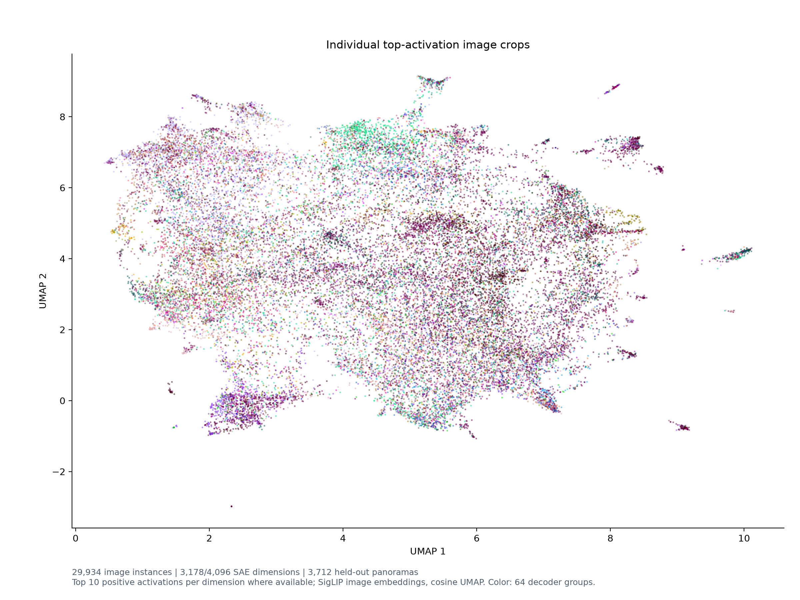

# Top10 image-instance semantic UMAP

每个散点是一张图像中的一个高激活裁剪实例，而不是一个 SAE 维度。每维按不同全景的最大正激活排名，最多取前 10 名：29,934 个点来自 3,178 个维度。其中 2,920 维有完整 Top10；918 维在当前 3,712 个验证全景里没有正激活，无法产生真实图像点。

每个裁剪使用已保存的 SigLIP 图像 embedding，直接以余弦距离重新拟合 UMAP。颜色沿用 64 个 decoder 聚类组，组标签和城市不参与拟合。同一图像可能为多个 SAE 维度提供不同的激活区域；每个维度与全景组合最多保留一个方向。激活排名只针对固定验证样本，不代表全量 NAS。UMAP 二维距离不构成统计显著性证据。

交互式实例图：`index.html`（完整交互页仅在服务器） · [逐点坐标与来源](instance_umap.csv)

