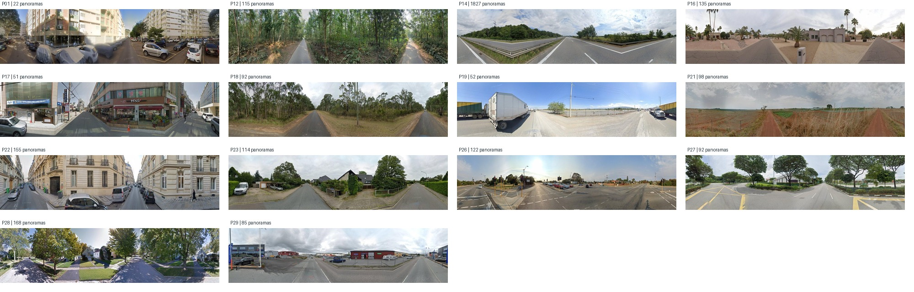
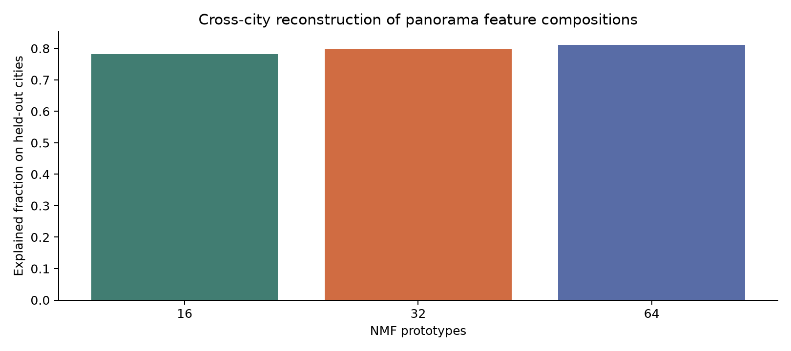

# Panorama landscape prototypes

基于 3,712 个验证全景、29 城的 4,096 维 SAE 最大正激活，保留至少在 20 个全景出现的 2,863 维。使用每维正激活第 95 百分位截断、平方根变换与逐全景 L2 归一化。主实验用 NMF 分解成 32 个可叠加的景观组合，16 和 64 作为敏感性分析。

城市留出 3 折的 32 原型平均解释率为 0.797；城市内独立打乱每维激活后，基线为 0.722，差为 0.075，置换检验 p=0.0250（39 次）。两次独立随机初始化原型匹配余弦均值为 0.863。按至少 20 个主导全景、5 座城市及匹配余弦不低于 0.8，有 14 个成分达到候选原型门槛并通过当前目视 QC 复核。成分 24 的代表图中仍有隧道／下穿通道，已标记为 QC 待复核，不计入候选数。

图中每个原型的行是一个真实四方向全景，特征编号链接到原始激活证据。NMF 只证明维度组合的重复性，不检验相邻关系或固定空间排布。这些编号是候选原型，尚未做逐个语义命名。

查看原型与四方向实例：`index.html`（完整交互页仅在服务器） · [原型表](prototypes.csv) · [逐全景分配](panorama_assignments.csv) · [完整统计](summary.json)

