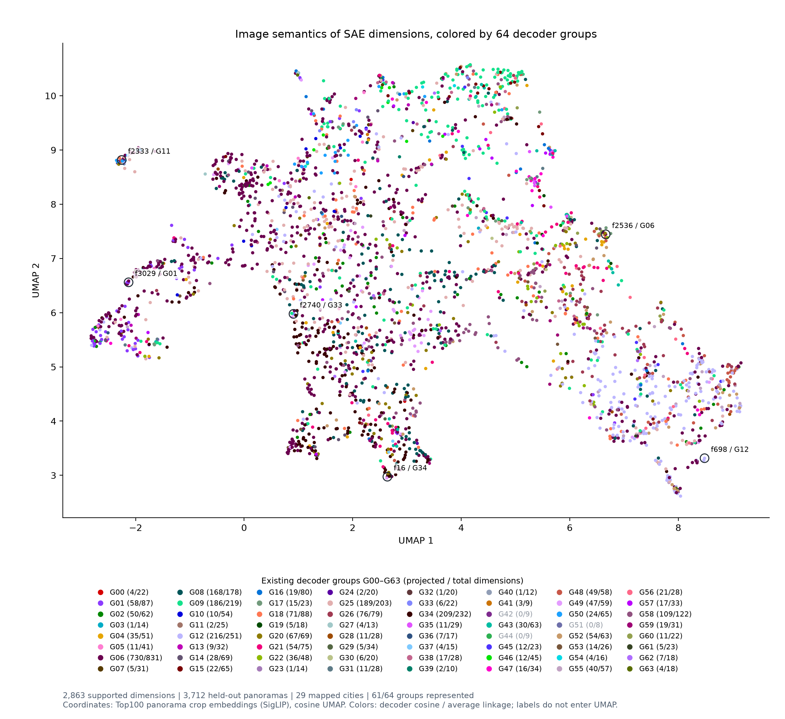
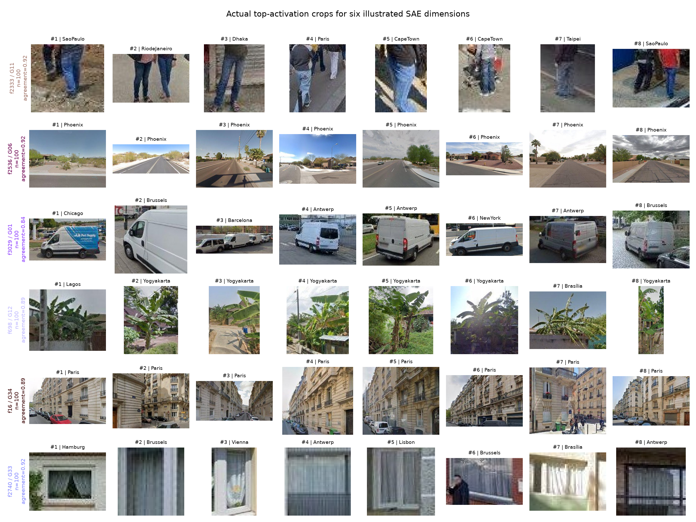
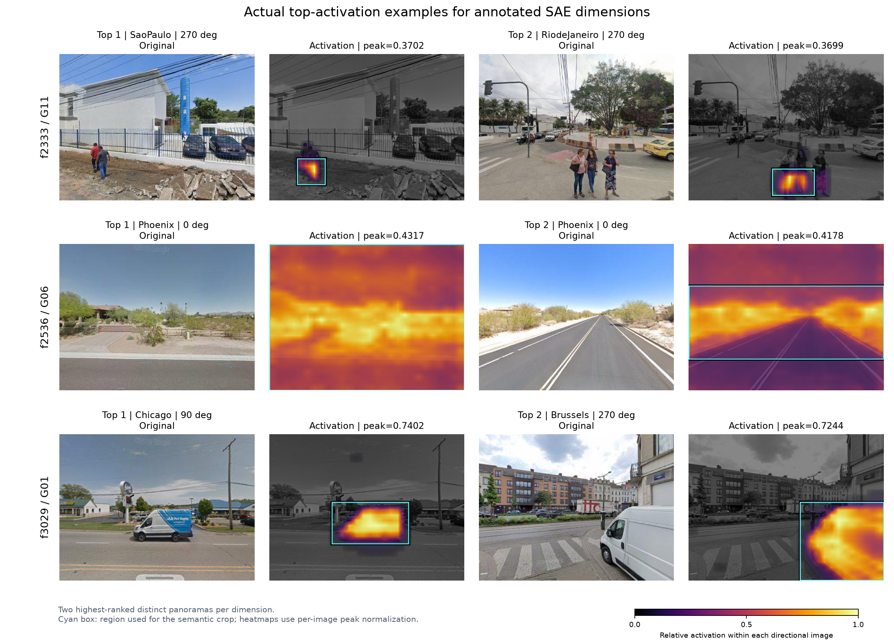
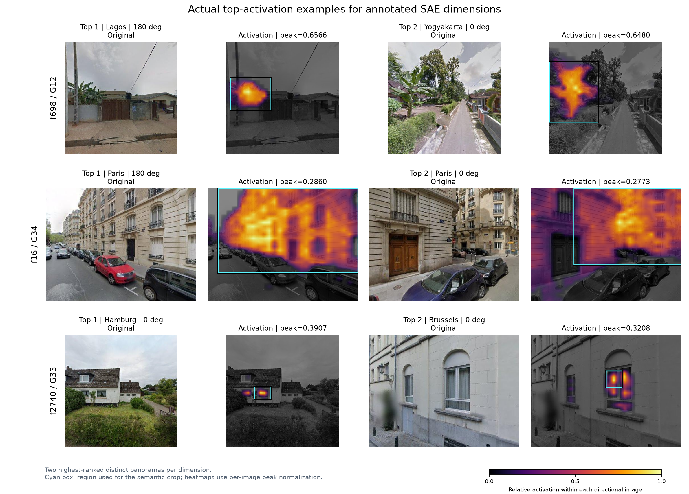

# Current ViT-L SAE: dimension-level image semantic UMAP

使用当前 W4096、K32 模型的固定验证集：29 个映射可靠城市，3,712 个完整全景，14,848 张方向图。未重新提取 DINO 特征或训练 SAE。Moscow 因映射尚未核对而排除。

逐维度按全景内最大正稀疏激活排名，同一全景只保留最佳方向。每个全景的全部 3,136 个 patch 构成独立 BatchTopK 预算，使用 FP32 推理。候选集为训练前固定的验证点位，不混入之前按 64 组检索的实例。

每维最多 Top100；峰值 50% 阈值连通区域外扩一个 patch，最小 3×3 patch，映射回原始图像裁剪。得到 282,004 个逐维实例，其中 272,190 个不同裁剪区域。相同像素区域只编码一次，汇总时仍保留各维度自己的等权实例。

干净裁剪经 SigLIP base patch16 224 图像 encoder，逐例 L2 归一化，逐维等权平均后再次归一化。坐标不使用空间位置、城市标签、decoder 权重、64 组标签或 VLM 文字描述。embedding 一致性仍在逐维详情中保留，它不是语义准确率。

散点颜色改为当前 SAE 已有的 64 组 decoder 聚类标签 G00–G63（decoder 余弦距离、平均链接）；每个点仍是一个原始 SAE 维度，并非只有 64 个点。沿用标签及组编号，不重新聚类或拟合 UMAP。当前 61 组有足够实例进入投影；G42、G44、G51 暂无投影成员，图例保留所有 64 种独立组色，暂无投影的组只将文字灰显。图例括号显示“已投影数 / 总维度数”，例如 G42 为 0/9；0 不表示组内没有 SAE 维度。组色仅辅助对照 decoder 分组与图像语义之间的关系，不预设二者完全一致。

使用余弦 UMAP，n_neighbors=30、min_dist=0.1、seed=42。至少 20 个有效实例才投影：2,863 个维度纳入，1,233 个维度证据不足或原型退化，2,737 个维度有完整 Top100。

图中六个标注用于实例展示：保留 f2536、f3029、f698、f16，将 f2763 替换为 f2333，将 f14 替换为 f2740。两个替换维度经过人工目视核对：检查前八名及第 25、50、75、100 名裁剪，并检查前两名原图与激活图。f2333 主要呈现行人下半身、裤装与腿部，f2740 主要呈现带窗帘的窗户；这是基于实例的暂定描述。人工选择仅决定展示哪些维度，不参与 embedding、UMAP 拟合或聚类。每个展示维度都有完整 Top100，实例图仍严格展示激活排名前八例，原图与激活图严格展示前两例，不人工换图。

UMAP 只辅助观察局部关系；不据二维距离宣称类别边界、统计显著性或冗余。平均原型可能掩盖多义特征，应查看完整实例；Top100 仅针对本候选集。

本地交互页面：`/root/code/urban-visual-gene/outputs/experiments/nas_30city_vitl_panorama_w4096_k32/analysis/semantic_umap_top100/index.html`（仅服务器）：点击图例高亮指定组，其余点淡化；悬停预览、点击维度，逐例查看干净裁剪、原图、激活和四方向全景。页面原图通过本机 NAS 路径链接，分享前需另行打包。

色表使用 Colorcet 3.2.1 的 Glasbey dark 前 64 色，一组一色，固定顺序；静态散点与交互页面均使用不透明的相同 RGB 值。暂无投影的组也保留自己的颜色。来源：Peter Kovesi / Colorcet contributors，CC BY 4.0；[色表说明](https://colorcet.holoviz.org/user_guide/Categorical.html)。

[全部维度的分组与坐标](feature_semantic_umap_groups.csv) · [可复现组色](group_palette.json)

## Annotated dimensions: original images and activations

每维展示当前候选集激活排名前两位的不同全景，使用已保存的逐维稀疏激活。黄色较强，暗色较弱；青色框为语义裁剪区域。热图按每张方向图的峰值归一化，跨图强度请参照原始 peak。

