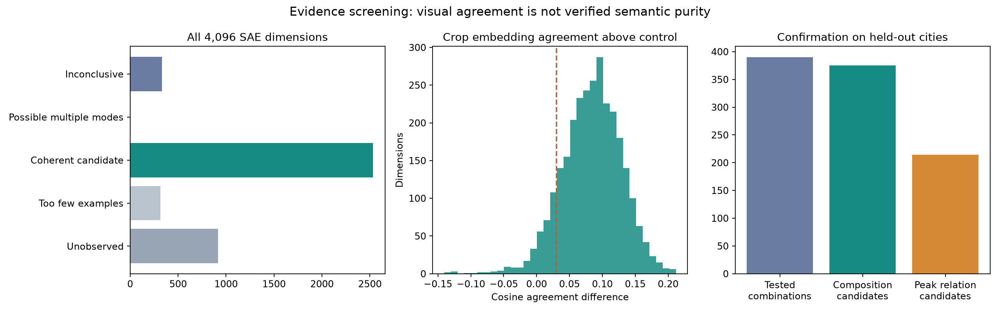

# SAE 维度是否构成明确语义单元？

本轮使用 3,712 个验证全景、29 城、282,004 份已缓存激活区域 embedding。没有重新提取 DINO 特征、训练 SAE 或占用 GPU。

## 逐维证据

所有 4,096 维都保留。自动筛查结果：

- 样本内未观察到正激活：918 维。
- 实例不足，暂不能判断：315 维。
- 视觉一致性候选，语义待核对：2,530 维。
- 可能存在多种视觉模式：3 维。
- 视觉证据尚不明确：330 维。

**视觉一致性不等于明确语义。** 本轮尚未对任何维度完成独立语义标注验证；状态不代表物体准确率或语义纯度。纹理、光照和异常也可能一致。未激活仅针对本样本，不能判为整个训练集的死亡维度。

## 组合与空间证据

每城 1-km 网格保留一个点后，共 3,175 个全景。发现集为 2,082 点／19 城；确认集为 1,093 点／10 城，两者城市不重叠。

在发现集选出 390 个二项／三项组合，确认集有 375 个达到组合候选判据；其中 214 个还达到重复峰值关系候选判据。完整结果包括未确认的候选。

这些是统计与激活位置证据，尚未完成景观语义核验。可能冗余的维度已单独标记；三项共现不等于三阶相互作用。1-km 稀疏化未消除全部空间相关性，p/q 为探索性证据。

交互实例：`index.html`（完整交互页仅在服务器） · [全部维度](dimension_audit.csv) · [全部组合](motifs.csv) · [分析样本](analysis_sample.csv) · [完整设计和限制](EXPERIMENT_DESIGN.md)

