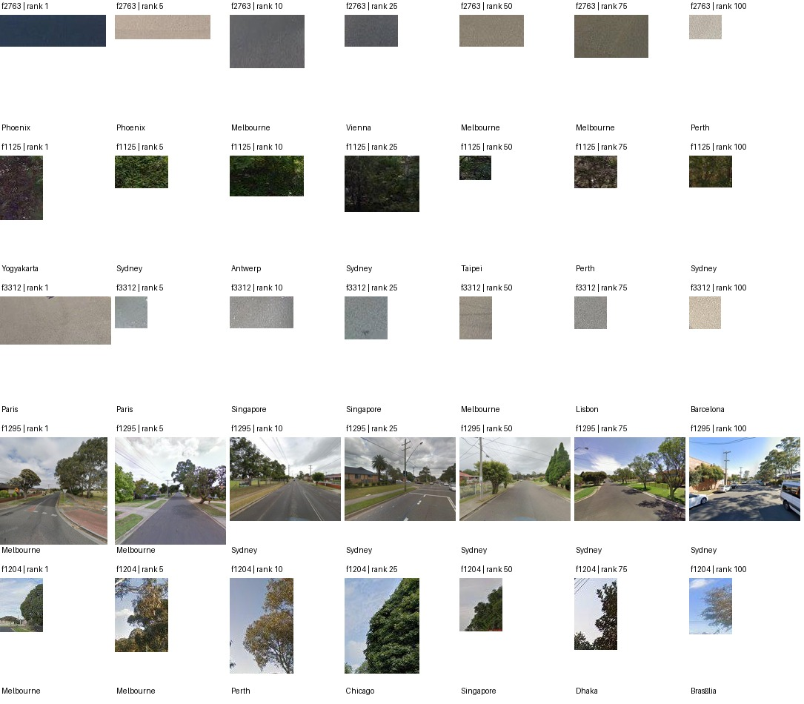
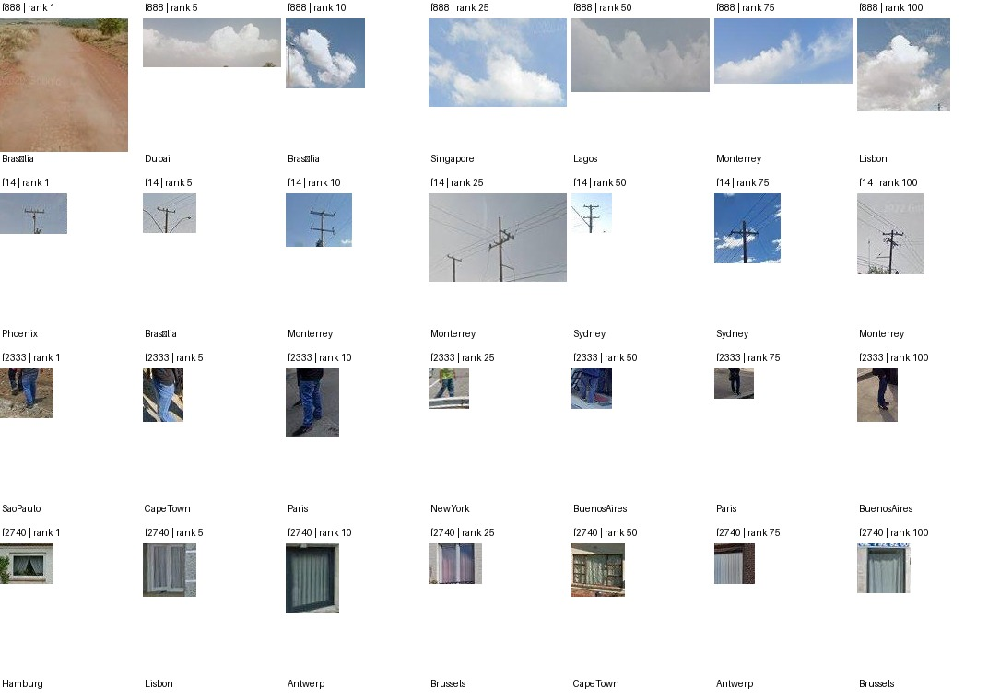

# 为什么以 Top100 embedding 为主，仍保留全景索引？

## 当前直接使用的输入

逐维审查直接读取已有的 `crop_embeddings.f32.npy` 和对应 `crops.jsonl`：282,004 条激活区域观测，每条是一个 768 维、单位归一化的 SigLIP 图像 embedding，带有 SAE 维度、激活排名、原图、裁剪框、城市和全景编号。没有重新抽取图像特征，也没有重训 SAE。

4,096 个维度中，2,737 维有完整 Top100；其余维度保留所有已观察到的正激活实例，不补图凑满。918 维在这个来源样本内没有正激活，不能据此判定其在整个训练集或其他图像上都不激活。

这些 Top100 原本是在 29 个已核对图像映射城市的 3,712 个留出全景中选出的。3,712 是已有 Top100 的来源范围，不是本轮重新选取或编码的图像数量。

## 两种数据分别回答什么

| 问题 | 主要输入 | 能回答的内容 |
|---|---|---|
| 一个 SAE 维度是否视觉一致？ | 该维度已有 Top100 区域 embedding | 实例是否相近、是否可能混有多种模式 |
| 不同维度是否可能语义重复？ | 不同维度的区域 embedding 分布与实例 | 近义或冗余候选，仍需原图核对 |
| 哪些维度在同一街景中共同出现？ | 逐全景、逐维的完整缓存激活 | 保留分母和未进入 Top100 的响应，估计共现关系 |
| 共现维度是否有重复的空间排列？ | 全景编号、四方向图像和已有峰值位置 | 激活峰值的相对位置是否有额外规律 |

仅凭两个维度的 Top100 榜单交集，可以描述“高激活检索集合的重叠”，但不能把它当作完整的街景共现率：某个全景未进入 Top100，不等于该维度没有在此激活。因此，语义审查以区域 embedding 为主；组合和空间检验另用已经保存的全景激活记录。二者通过全景编号连接，无需重跑编码器。

## 第一轮视觉复核示例

以下是对现有裁剪拼图的本轮视觉检查，仅是工作注释，没有独立人工标签，也不作为全维度语义准确率：

- **f14**：所展示实例大多包含电线杆、横担或电线，可以先作为一个与架空电力设施有关的候选。
- **f2333**：所展示实例大多聚焦于行人的腿、裤子和鞋，是物体部件候选。
- **f2740**：所展示实例多是窗户与窗帘，需要继续判断是窗户结构、窗帘纹理还是两者混合。
- **f2763 / f3312**：所展示实例多是灰色或浅色表面，说明高度一致也可能来自表面纹理，而非可独立命名的物体。
- **f888**：所展示多数实例是云，但最高排名裁剪呈现土路区域，需核对激活与裁剪过程；不能据少量拼图直接判为纯粹的“云”维度。
- **f1295**：所展示实例包含较完整的绿化、道路、住宅街景，可能响应场景组合或较大上下文，而非单个元素。

拼图横跨排名 1、5、10、25、50、75、100；它们是用于检查的选例，不是这些维度全部实例的人工标注。

## 解释边界

本轮用最多前 20 个实例形成视觉中心，实例较少时使用前半部分，再检查后续排名是否延续相似性。这是同一 Top100 内部的稳定性检查，不能替代独立实例和人工核验。Embedding 也会受颜色、纹理、裁剪范围及编码器偏好影响。

最终应区分“视觉一致候选”“可能多模式”“证据不足”与真正经过核验的语义名称。景观原型也应以多个真实例子及组合证据支持，不能直接把一个聚类编号或一个 SAE 维度称为景观类别。
