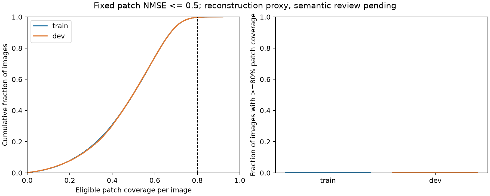
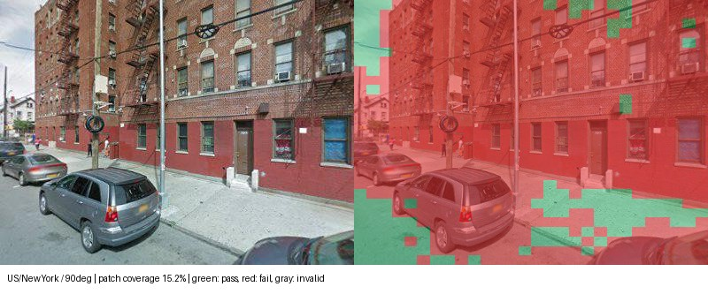
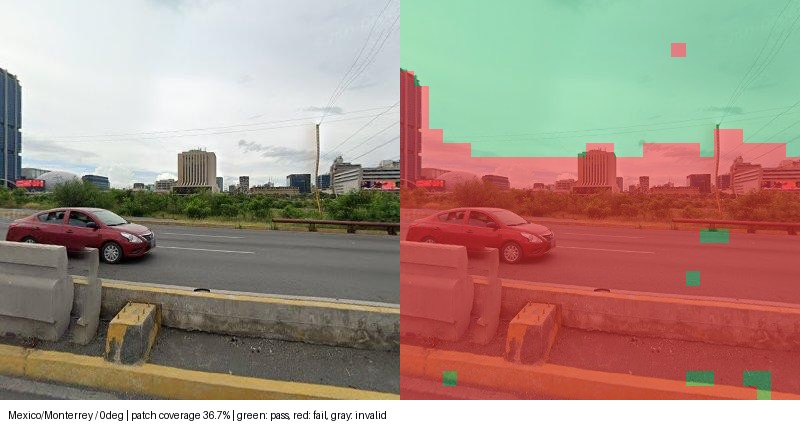
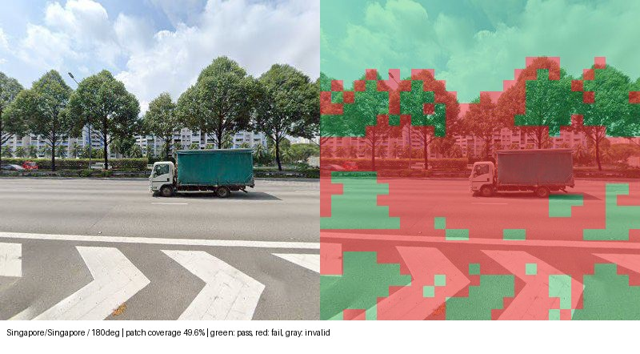
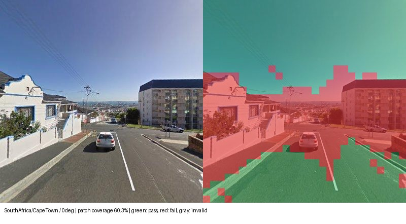
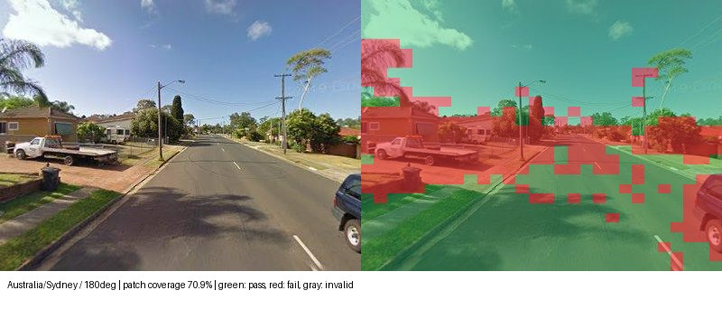

# 逐图80%有效patch覆盖实验

以下是SAE激活重建覆盖，尚未完成独立语义核查。测试集保持封存。

| 划分 | 方向图像 | 达到逐图80%要求的比例 | 最差图像覆盖率 |
| --- | ---: | ---: | ---: |
| train | 240,932 | 0.28% | 0.00% |
| dev | 51,020 | 0.28% | 0.00% |

绿色patch达到固定质量门槛，红色未达到，灰色无有效目标激活。实例按开发覆盖率分位数选择。

