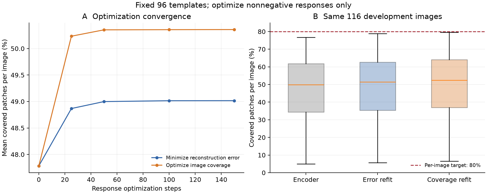

# 冻结模板的逐图响应优化诊断

开发集29城市各1全景，四方向共116张图；冻结96个模板，只优化非负响应。
同一批图分别记录编码器起点、仅优化全图能量误差、直接优化逐图覆盖损失的结果。
每种路线保留优化中观测到的最佳硬覆盖；不加响应稀疏约束，因此是宽松的探索诊断。
有限步优化不能给出模板表达能力的理论上限；NMSE达标也不是语义解释。测试集未使用。

| 设置 | 达标图像 | 平均patch覆盖 | P10覆盖 | 全景四方向全达标 | 平均图像NMSE |
| --- | ---: | ---: | ---: | ---: | ---: |
| 现有编码器 | 0/116 (0.0%) | 47.8% | 22.1% | 0/29 | 0.533 |
| 只降重建误差 | 0/116 (0.0%) | 49.1% | 24.4% | 0/29 | 0.524 |
| 直接优化逐图覆盖 | 0/116 (0.0%) | 50.4% | 26.2% | 0/29 | 0.527 |

每张图每条路线运行150步，学习率0.15；详细协议和逐图记录见服务器 `outputs/response_refit_v1/`。

## 口径与收敛检查

每个patch只有在其4096维激活重建NMSE≤0.5时才计为覆盖；每张方向图覆盖至少80%才达标。本批116张图各有784个有效patch，无无效patch被排除。该指标只衡量重建，不等同于语义解释。

| 优化步数 | 仅降重建误差：平均覆盖 | 直接优化覆盖：平均覆盖 |
| ---: | ---: | ---: |
| 0 | 47.784% | 47.784% |
| 25 | 48.867% | 50.233% |
| 50 | 48.998% | 50.353% |
| 100 | 49.015% | 50.356% |
| 150 | 49.016% | 50.358% |

上表为相同步数的实际响应；主表按每张图分别保留优化中观测到的最佳硬覆盖，因此数值略有差别。第0步用float32重算冻结解码器，与主表原始混合精度推理的起点有微小数值差异。

## 诊断结论

直接优化覆盖后，116张图均有提升，但平均仅增加2.65个百分点，仍无图达到80%。从50步到150步，平均覆盖只增加约0.006个百分点，这两条优化路线均已明显趋于稳定。有限步响应搜索未发现能够接近目标的解，提示只改编码器或增加当前响应求解步数可能收益有限；现有模板组成、数量、秩和空间约束应优先进入对照实验。该结果不能证明冻结字典的理论上限，也不能单独判断具体哪项结构约束负责。

GPU 1完成两条路线共约134秒。已核查116个唯一图像记录、29城市各四方向、原模型SHA256未改变；测试集继续封存。

