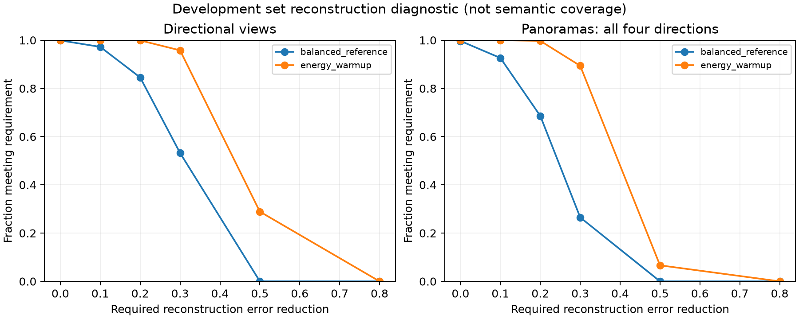

# 原型覆盖率第一轮试验

测试集保持封存。以下均为开发集重建诊断，不代表语义覆盖率。

| 训练设置 | 开发集 NMSE | 平均有效模板数 |
| --- | ---: | ---: |
| balanced_reference | 0.7082 | 36.15 |
| energy_warmup | 0.5510 | 28.57 |

人工核查表已准备 290 个开发全景，标签为空；80% 语义覆盖目标尚未验证。
本轮每尺度32个模板、每组4轮，只用于筛选后续完整训练的设置。尚未完成多种子稳定性、独立语义核查和最终测试。
